# Project Saarthi — Agent Flow Diagrams

---

## Diagram 1 — Message Pipeline (every inbound message)

```mermaid
flowchart TD

    %% ── ENTRY ──────────────────────────────────────────────────────────────
    START([📱 Inbound WhatsApp message]) --> MTYPE

    MTYPE{Message type?}
    MTYPE -->|audio| AUDIOREPLY[Reply: Please send as text]
    MTYPE -->|image / sticker / video| MIGNORE[Ignore silently]
    MTYPE -->|text| LOAD

    AUDIOREPLY --> ZEND0([End])
    MIGNORE --> ZEND0

    LOAD[Load lead + session from Supabase by phone\nCreate new lead row if first contact] --> AICHK

    AICHK{ai_paused = true?}
    AICHK -->|YES — counselor active| SILENT[Log inbound only\nDO NOT auto-reply]
    SILENT --> ZEND1([End])
    AICHK -->|NO| DPDP

    %% ── DPDP CONSENT GATE ──────────────────────────────────────────────────
    subgraph CG [" 🔐  DPDP Consent Gate "]
        DPDP{Consent status?}

        DPDP -->|new parent\nconsent_given=false\nconsent_pending=false| CSEND
        DPDP -->|consent_pending=true\nawaiting reply| CPARSE
        DPDP -->|consent_given=true| PASS

        CSEND[Send consent request message\nExplain: what is collected, why, opt-out\nSet consent_pending = true\nStore phone + wa_name ONLY — no other data yet]
        CSEND --> ZEND2([End — await reply])

        CPARSE{Parent replied?}
        CPARSE -->|YES / ok / agree| COK
        CPARSE -->|STOP / no / opt out| CNO
        CPARSE -->|any other message| CREMIND

        COK[consent_given = true\nconsent_given_at = now\nconsent_pending = false\nSend welcome: Hi! Which class are you looking at?]
        COK --> ZEND3([End — normal flow resumes next message])

        CNO[consent_declined = true\nlead_status = opted_out\nSend: We will not contact you again.\nDWPS direct number provided]
        CNO --> ZEND4([End — permanently closed])

        CREMIND[Re-send consent message\nDO NOT process their question]
        CREMIND --> ZEND5([End])
    end

    PASS --> CTWA

    %% ── CTWA + REACTIVATION ─────────────────────────────────────────────────
    CTWA{First message +\nCTWA referral present?}
    CTWA -->|YES| CTWAACT[Store attribution: ctwa_source_id, headline, ctwa_clid\nSend personalised opener based on ad topic\nAttach resource matched to ad content]
    CTWAACT --> REACT
    CTWA -->|NO| REACT

    REACT{lead_status =\nbroadcast_sent?}
    REACT -->|YES — dead lead replied| REACTACT[Update status → reactivated\nReset session to discovery stage\nSend warm re-engagement reply]
    REACTACT --> ROUTER
    REACT -->|NO| ROUTER

    %% ── 4-PATH ROUTER ───────────────────────────────────────────────────────
    ROUTER{4-PATH ROUTER}

    ROUTER -->|"is_fee_query()\nfees cost charge tuition ₹\nhow much transport bus"| P1S
    ROUTER -->|"is_answering()\n≤5 words OR last agent message\nasked for name / grade / date / area"| P2S
    ROUTER -->|"is_conversational()\nhi hello ok thanks emoji-only"| P3S
    ROUTER -->|"else — knowledge question"| P4S

    %% ── PATH 1 : FEE HARDLOCK ───────────────────────────────────────────────
    subgraph FH [" Path 1 — Fee Hardlock 🔒 "]
        P1S[Query Supabase fee_data by class_name + board\nQuery transport_data if area known in session\nFormat structured breakdown — LLM never touches numbers]
        P1S --> P1AREA{area known\nin session?}
        P1AREA -->|NO| P1ASK[Append: Which area are you from?]
        P1AREA -->|YES| P1FPDF
        P1ASK --> P1FPDF
        P1FPDF{Fee PDF already\nsent this session?}
        P1FPDF -->|NO| P1ATT[Flag Fee Structure PDF for attachment]
        P1FPDF -->|YES| P1X([Path 1 → merge ↓])
        P1ATT --> P1X
    end

    %% ── PATH 2 : ANSWERING ──────────────────────────────────────────────────
    subgraph AH [" Path 2 — Answering 🎯 "]
        P2S[extract_signals via Gemini\nJSON: name grade board area school visit_date concern]
        P2S --> P2M[Merge signals into session context\nUpdate Supabase lead immediately — do not wait]
        P2M --> P2R[Gemini contextual reply\nNO Pinecone\nUses session history + context only]
        P2R --> P2X([Path 2 → merge ↓])
    end

    %% ── PATH 3 : CONVERSATIONAL ─────────────────────────────────────────────
    subgraph CH [" Path 3 — Conversational 💬 "]
        P3S[Gemini contextual reply\nNO Pinecone\nWarm and brief — move conversation forward]
        P3S --> P3X([Path 3 → merge ↓])
    end

    %% ── PATH 4 : RAG ────────────────────────────────────────────────────────
    subgraph RH [" Path 4 — RAG 🔍 "]
        P4S{needs_rewrite?\ncontains: what about / also /\nit / that / this — pronoun reference}
        P4S -->|YES| P4FULL[Gemini full query rewrite\nResolve pronoun using session history\nProduce self-contained question]
        P4S -->|NO| P4CHEAP[Cheap expansion\nAppend grade + board from session context\ne.g. Class 3 Cambridge + original query]
        P4FULL --> P4PINE
        P4CHEAP --> P4PINE

        P4PINE[Parallel Pinecone search\nknowledge namespace: top_k = 5 text chunks\nresources namespace: top_k = 1 file metadata]

        P4PINE --> P4CONF{top knowledge\nscore ≥ 0.80?}
        P4CONF -->|NO| P4FB[FALLBACK\nI do not have a confident answer for that.\nEmail alert to admissions team\nFlag Needs Attention in console\nfallback_count++ on lead]
        P4FB --> ZFAIL([End])

        P4CONF -->|YES| P4GEN[Gemini generate_reply\nSystem prompt + full session context\n+ top 5 RAG knowledge chunks\n+ last 8 turns of conversation history]

        P4GEN --> RGATE{Resource Gate\nAll 5 must pass}
        RGATE -->|"① resource score > 0.70\n② not in session.resources_shared\n③ parent asking — not just answering\n④ not sent on the previous turn\n⑤ session total resources < 3"| P4ATT[Flag resource for attachment\nAdd to session.resources_shared]
        RGATE -->|ANY gate fails| P4NONE[Text only — no attachment]
        P4ATT --> P4X([Path 4 → merge ↓])
        P4NONE --> P4X
    end

    %% ── CONVERGENCE ─────────────────────────────────────────────────────────
    P1X --> LCAP
    P2X --> LCAP
    P3X --> LCAP
    P4X --> LCAP

    LCAP[Lead Capture Injection\nAppend ONE natural question at end of response — never two at once\nPriority: grade → name → board → area → tour date\nAsk tour date only from turn 4 onwards\nSkip any field asked twice with no answer — mark as declined]

    LCAP --> SADV[Stage Advancement\ndiscovery → exploration : first real question answered\nexploration → consideration : grade + board both known\nconsideration → intent : parent asks how to apply or visit\nintent → conversion : tour date confirmed → write to visits table + schedule D-1 reminder]

    SADV --> STXT[Send WhatsApp text message]
    STXT --> RESQ{Resource flagged?}
    RESQ -->|PDF| SPDF[send_document via Meta API]
    RESQ -->|YouTube| SYTB[Send YouTube URL as plain text\nWhatsApp renders preview automatically]
    RESQ -->|NO| PERS
    SPDF --> PERS
    SYTB --> PERS

    PERS[Persist:\nturn_count++ / history trimmed to last 16 entries = 8 turns\ntopics_covered + resources_shared + stage saved\nlead.last_active = now\nLog to conversation_logs: path_taken + pinecone_score + resource_sent]
    PERS --> ZFINAL([End])
```

---

## Diagram 2 — Background Operations

```mermaid
flowchart TD

    %% ── 23-HOUR FOLLOW-UP ───────────────────────────────────────────────────
    subgraph F23 [" ⏰  23-Hour Follow-Up — Cloud Scheduler fires every hour "]
        FA([Scheduler fires]) --> FB[Query sessions:\nlast_message_at < now − 23 hours\nAND lead_status = active\nAND ended_at IS NULL]
        FB --> FC{Sessions found?}
        FC -->|NO| FSKIP([Skip])
        FC -->|YES| FD[For each lead:\nSend saarthi_follow_up_v1 template\nHi name still thinking about DWPS?\nHappy to help if you have questions.]
        FD --> FE[Log send to broadcast_sends]
        FE --> FF{Lead replies?}
        FF -->|YES — window resets| FG[Main pipeline fires via webhook\nDiagram 1 runs normally]
        FF -->|NO after 24h more silence| FH[Cloud Scheduler marks\nlead_status → cold]
    end

    %% ── VISIT D-1 REMINDER ──────────────────────────────────────────────────
    subgraph VREM [" 📅  Visit D-1 Reminder — Cloud Scheduler fires at 9am daily "]
        VA([Scheduler fires at 9am]) --> VB[Query visits:\nvisit_date = tomorrow\nAND attended IS NULL\nAND reminder_sent_at IS NULL]
        VB --> VC{Visits found?}
        VC -->|NO| VSKIP([Skip])
        VC -->|YES| VD[For each visit:\nSend saarthi_visit_reminder_v1 template\nHi name your campus visit is tomorrow\nDate + Time + what to bring]
        VD --> VE[Update visits.reminder_sent_at = now]
        VE --> VF{Parent replies\nto reschedule?}
        VF -->|YES| VG[Webhook fires\nis_answering path handles it\nExtract new date → update visits table\nSend new confirmation]
        VF -->|NO reply| VH[Visit proceeds as scheduled\nTeam notified by dashboard]
    end

    %% ── DEAD LEAD REACTIVATION ──────────────────────────────────────────────
    subgraph DLRX [" 📢  Dead Lead Reactivation — Manual trigger by Pavan "]
        RA([Pavan runs broadcast script]) --> RB[Query leads:\nlead_status IN cold dead\nAND last_active < now − 30 days\nAND broadcast_sent = false\nAND consent_declined = false]
        RB --> RC[For each lead with 200ms delay between sends:\nSend saarthi_reactivation_v1 template\nHi name it has been a while...\nSeats still available for 2026-27]
        RC --> RD[Update lead:\nbroadcast_sent = true\nLog to broadcast_sends table]
        RD --> RE{Lead replies?}
        RE -->|YES within 48h| RF[Webhook fires via Diagram 1\nlead_status → reactivated\nNew session at discovery stage\nWarm re-engagement reply sent]
        RE -->|NO after 48h| RG[Scheduler marks lead_status → dead]
    end

    %% ── LIVE TAKEOVER CONSOLE ───────────────────────────────────────────────
    subgraph LTC [" 🎮  Live Takeover Console "]
        TA([Fallback triggered\nOR counselor decides to intervene]) --> TB[Console flags conversation:\nNeeds Attention badge\nShows parent question + full thread]
        TB --> TC{Counselor clicks\nTake Over?}

        TC -->|YES| TD[Set ai_paused = true\nAI stays silent on all future messages\nuntil manually resumed]
        TD --> TE[Counselor types reply\nPOST /conversations/phone/reply\nSent from same WhatsApp number as AI]
        TE --> TF[Logged: path_taken = live_counselor]
        TF --> TG{Done replying?}
        TG -->|NO — more needed| TE
        TG -->|YES| TH{Resume AI?}
        TH -->|YES| TI[Set ai_paused = false\nAI resumes on next parent message\nDiagram 1 runs normally]
        TH -->|NO — stay paused| TJ([Stays in takeover mode\nuntil manually resumed])

        TC -->|NO — leave to AI| TK([AI fallback message already sent\nConversation continues normally])
    end
```

---

## 4 Meta Templates — Submit Day 1 for Meta Approval

| Template | Trigger | Wait time |
|---|---|---|
| `saarthi_consent_v1` | First ever message from new parent | Instant |
| `saarthi_follow_up_v1` | 23h after last parent message | Cloud Scheduler |
| `saarthi_reactivation_v1` | Manual dead lead campaign | Manual trigger |
| `saarthi_visit_reminder_v1` | Day before scheduled visit | Cloud Scheduler 9am |

Meta approval takes 1–3 business days. Submit all four on Day 1.

---

*Agent Flow | Project Saarthi | Pavan Kumar Vuppaladadium × DWPS | July 2026*
