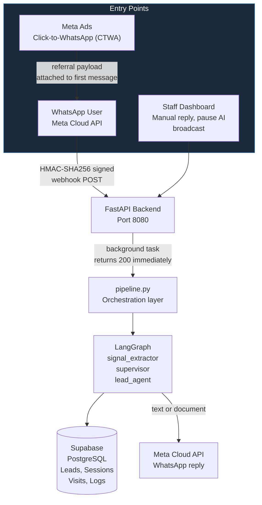
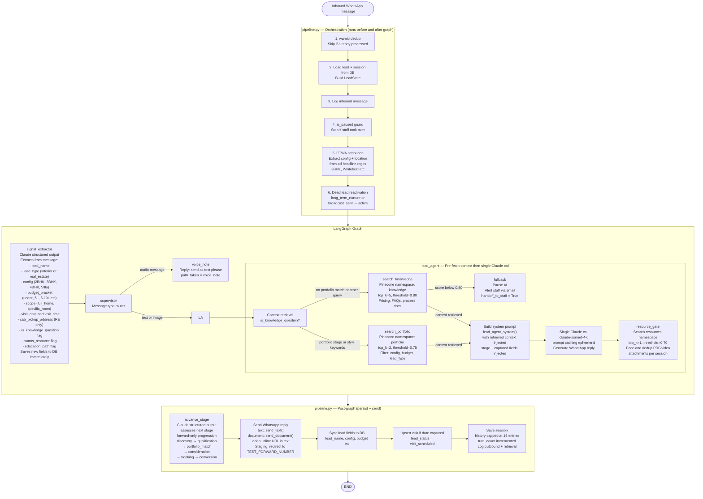
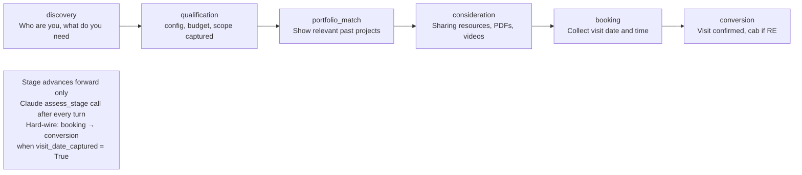
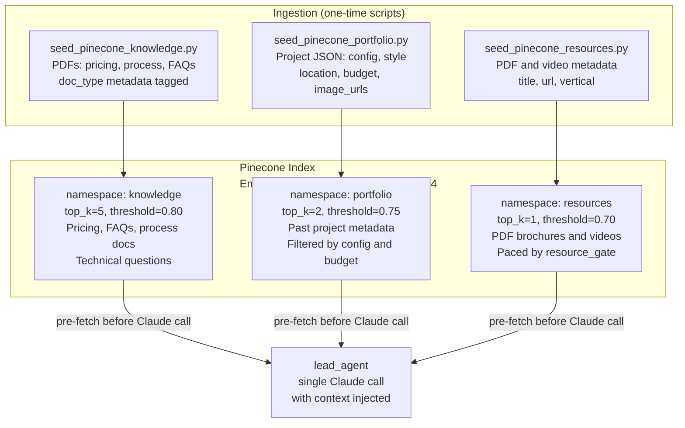
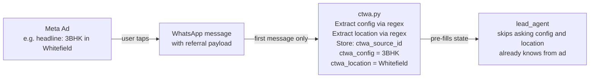
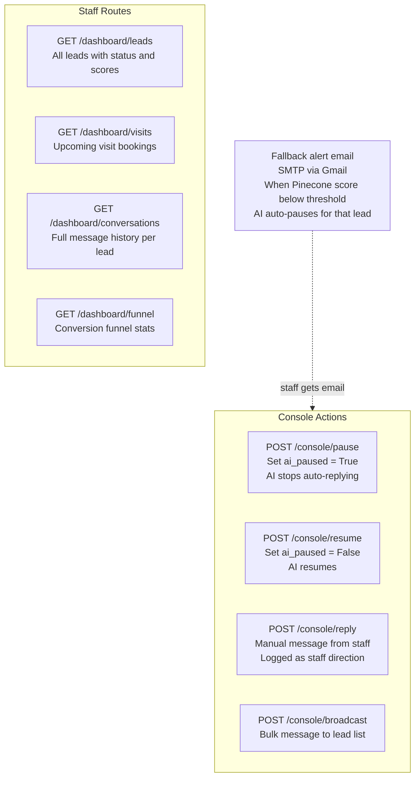
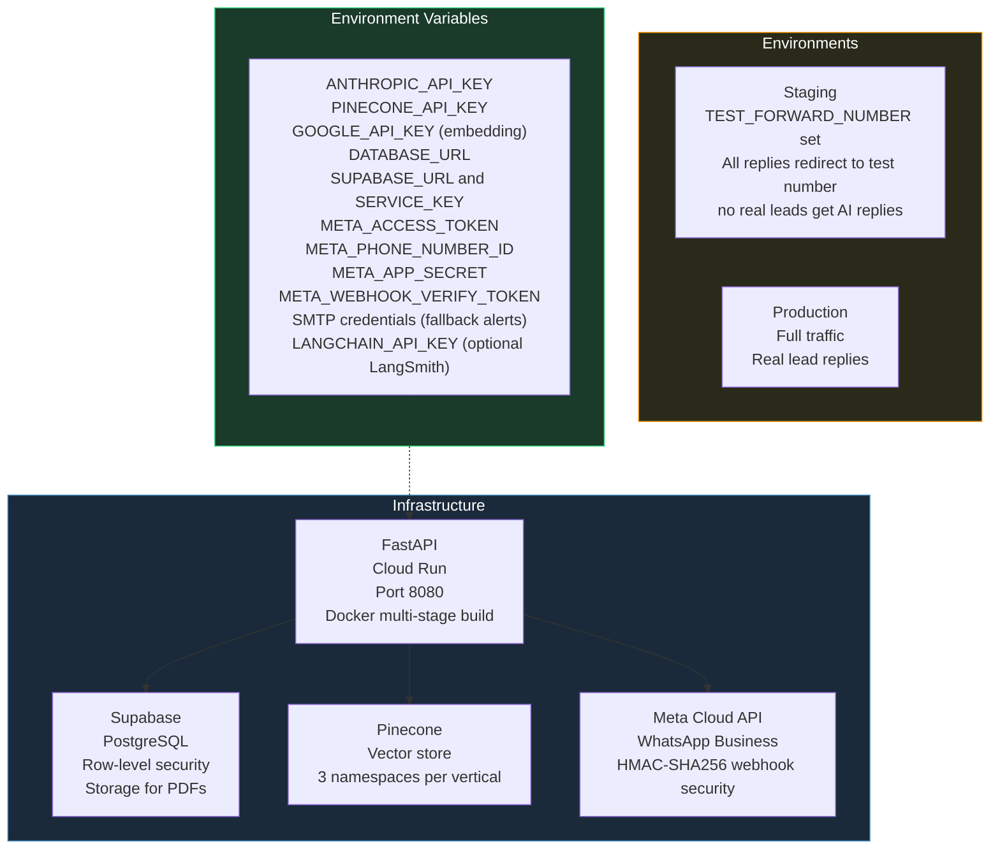

# Speed-to-Lead — WhatsApp AI Agent Architecture

## System Overview

---

## Detailed LangGraph Flow

---

## Conversation Stages

---

## Pinecone Knowledge Base

---

## CTWA (Click-to-WhatsApp) Attribution

---

## Staff Dashboard and Controls

---

## Deployment

**Deployment notes:**

| Config | Value |
|--------|-------|
| **Runtime** | Python 3.11, Poetry, Docker multi-stage build |
| **Server** | Uvicorn on port 8080 |
| **DB migrations** | `alembic upgrade head` runs on container startup |
| **Staging safety** | `TEST_FORWARD_NUMBER` redirects all outbound replies away from real leads |
| **Webhook security** | HMAC-SHA256 signature validation on every Meta POST |
| **Deduplication** | `wamid` check before processing prevents double-replies on Meta retries |
| **Observability** | LangSmith (optional via LANGCHAIN_API_KEY), latency fields in LeadState |
| **Embedding model** | Google text-embedding-004 (matches DWPS Pinecone index) |

---

## Component Summary

| Component | Tech | Role |
|-----------|------|------|
| **Orchestration** | LangGraph StateGraph | signal_extractor → supervisor → lead_agent |
| **LLM** | Anthropic Claude claude-sonnet-4-6 | Reply generation, signal extraction, stage assessment |
| **Prompt caching** | Anthropic cache_control: ephemeral | System prompt cached to cut latency and cost |
| **Vector store** | Pinecone (3 namespaces) | Knowledge, portfolio, resources retrieval |
| **Embeddings** | Google text-embedding-004 | Query and document embedding |
| **Database** | Supabase (PostgreSQL) | Leads, sessions, visits, conversation logs, retrieval logs |
| **WhatsApp** | Meta Cloud API | Inbound webhook + outbound text and document sends |
| **CTWA** | Meta referral payload | Ad config and location auto-extracted on first message |
| **Stage machine** | Claude structured output | Forward-only stage progression per turn |
| **Resource gate** | resource_gate.py | Paces PDF and video attachments, deduplicates per session |
| **Fallback** | SMTP email alert | Auto-pauses AI and alerts staff when confidence is too low |
| **Verticals** | Interior Design and Real Estate | Same graph, lead_type field controls prompts and routing |
